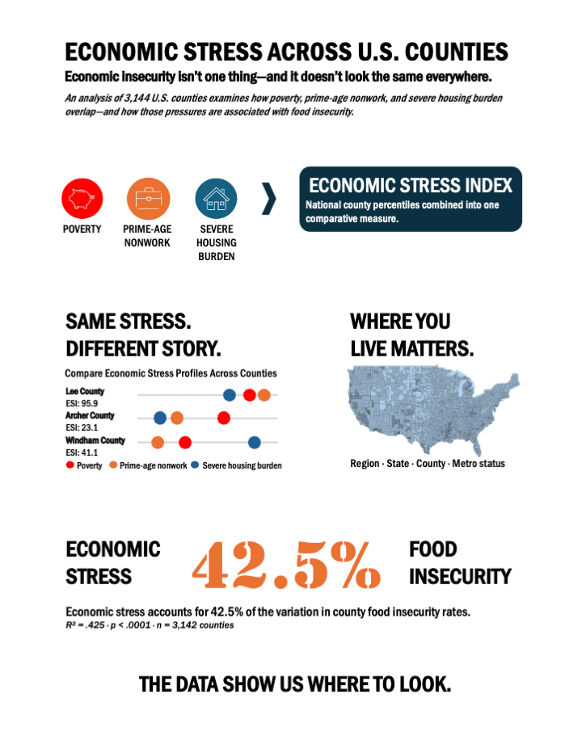

# Economic Stress Across U.S. Counties

**Economic insecurity isn't one thing—and it doesn't look the same everywhere.**

An independent county-level analysis exploring how poverty, prime-age nonwork, 
and severe housing burden combine into different patterns of economic stress 
across the United States—and how those patterns relate to food insecurity.

[Explore the interactive Tableau project](https://public.tableau.com/app/profile/suzanne.uvino/viz/U_S_CountyEconomicStressFoodInsecurity/EconomicStress)  
[Read the full analysis](https://suzannegulick.substack.com/p/there-is-no-single-map-of-american)

---

## The class ended, but my questions didn't.

This project began as a class assignment examining economic stress and food 
insecurity across U.S. counties. The original project worked—but it left me 
with questions.

Was unemployment really the best way to measure disconnection from work? 
What was hiding beneath a single economic stress score? Why did counties with 
similar levels of overall stress sometimes look so different underneath?

So after the class ended, I went back to the data and rebuilt the project.

## The Economic Stress Index

The Economic Stress Index (ESI) is a comparative county-level measure built
from three forms of economic pressure:

- **Poverty**
- **Prime-age nonwork**
- **Severe housing burden**

Each measure is converted to its position within the national county
distribution. The three component percentiles are then equally combined into
a single index ranging from lower to higher relative economic stress.

The ESI is not intended to define whether a county is economically “healthy”
or “unhealthy.” It is a tool for comparison—and the components underneath
the score matter.

Two counties can have nearly identical ESI scores while arriving there through
very different combinations of poverty, nonwork, and housing pressure.



## What I Found

### Similar stress scores can hide very different conditions

The Economic Stress Index is useful for comparison, but the overall score is only part of the story.

Among 207 counties with ESI scores between 48 and 52, **housing burden was the largest source of stress in 83 counties, prime-age nonwork in 81, and poverty in 43.**

Counties that look nearly identical according to the overall index can therefore be experiencing very different forms of economic pressure.

### Economic stress and food insecurity are strongly connected—but not interchangeable

Across 3,142 counties with paired observations, higher Economic Stress Index scores were associated with higher food insecurity rates.

**R² = 0.425 · p < 0.0001 · n = 3,142 counties**

The ESI accounts for approximately 42.5% of the variation in county food insecurity rates. That is a substantial relationship, but considerable variation remains.

And that remaining variation became one of the most interesting parts of the investigation.

### Housing told a different story

I expected severe housing burden to show a clear county-level relationship with food insecurity.

It didn't.

Housing burden tracked closely with a broader measure of renter housing pressure, but showed little relationship with county poverty, prime-age nonwork, or food insecurity. Rather than removing housing from the index, I kept it because the ESI was designed to capture **different forms of economic stress—not to maximize its ability to predict food insecurity.**

Housing pressure has a geography of its own.

### The counties that didn't fit led to another question

Some counties had substantially more—or less—food insecurity than their ESI scores would suggest.

When I examined those differences, geography emerged. I then brought additional measures into the analysis: **median household income, uninsured rate, and unemployment.**

Income and insurance stood out. Considering those measures alongside the ESI accounted for substantially more variation in county food insecurity than the ESI alone.

The result wasn't a tidy explanation.

It was a better question: **What else is shaping the difference?**

## How the Analysis Works

The project uses a reproducible Python workflow to integrate county-level data from multiple public sources into a common analytical dataset.

**Collect → Standardize → Integrate → Explore → Construct → Validate → Visualize → Interpret**

### Data preparation

County identifiers were standardized using **FIPS/GEOID codes** to support consistent joins across datasets. Source data were cleaned, validated, and combined into a county-level master dataset used throughout the analysis and Tableau visualizations.

Missing source values were retained rather than artificially imputed.

### Index construction

The three ESI components—poverty, prime-age nonwork, and severe housing burden—are converted to **national county percentiles** and equally combined.

This percentile-based approach allows measures with different underlying scales to be compared without treating their original units as equivalent.

### Statistical analysis

Exploratory analysis examined distributions, regional patterns, component behavior, and relationships among measures.

The relationship between the Economic Stress Index and county food insecurity was evaluated using **correlation and linear regression**. Additional analysis examined counties that departed substantially from the overall relationship and tested broader economic measures for additional context.

### Tools

**Python · pandas · Jupyter · statistical analysis · Tableau · Excel**

## The Analytical Trail

The project developed iteratively. Each stage raised questions that shaped
what came next.

**Question → Build → Analyze → Interrogate**

**Question**  
Reconsider the original labor-market indicator and investigate whether
unemployment adequately represents economic disconnection.

**Build**  
Integrate and validate county-level measures and construct the final analytical
dataset used in Tableau.

**Analyze**  
Examine the finalized ESI across 3,144 counties, including its distribution,
components, geographic patterns, and relationship with food insecurity.

**Interrogate**  
Return to unexpected patterns and anomalies, test whether they hold up,
identify what the data cannot explain, and follow the findings that contribute
meaningfully to the larger story.

> **ESI is a signal, not a diagnosis.**

## Data Sources

The analysis integrates county-level data from several national sources.
Because the most recent available year differs by dataset, source years are
reported explicitly rather than treated as contemporaneous observations.

- **U.S. Census Bureau — Small Area Income and Poverty Estimates (SAIPE), 2023**  
  Poverty rate and median household income

- **U.S. Census Bureau — American Community Survey (ACS) 5-Year Estimates, 2023**  
  Severe housing burden, derived from Table B25070 (Gross Rent as a Percentage
  of Household Income)

- **U.S. Census Bureau — American Community Survey (ACS) 5-Year Estimates, 2024**  
  Prime-age nonwork, derived from Table B23027 for adults ages 25–54

- **U.S. Census Bureau — Small Area Health Insurance Estimates (SAHIE), 2023**  
  Uninsured rate

- **U.S. Bureau of Labor Statistics — Local Area Unemployment Statistics (LAUS), 2025**  
  Unemployment rate

- **Feeding America — Map the Meal Gap 2026 (2024 data)**  
  Overall and child food insecurity rates

County identifiers were standardized using **FIPS/GEOID codes** to support
consistent joins across sources. The final analytical dataset contains 3,144
U.S. counties and county equivalents.

## Repository Structure

```text
Economic_Stress_US_Counties_2026/
│
├── data/
│   └── Economic_Stress_US_Counties_Master_ESI_C.xlsx
│
├── docs/
│   ├── Economic_Stress_US_Counties_One_Pager.pdf
│   └── Economic_Stress_US_Counties_One_Pager.png
│
├── notebooks/
│   ├── 02_Labor_Market_Indicator_Research.ipynb
│   ├── build_county_explorer_master.ipynb
│   ├── ESI_v2_statistical_analysis.ipynb
│   └── interrogate_economic_vulnerability.ipynb
│
└── README.md
```

### Notebooks

The notebooks document different stages of the investigation rather than
representing a single linear analysis.

- **`02_Labor_Market_Indicator_Research.ipynb`** — investigates alternatives
  to unemployment for the labor-market component of the ESI and documents
  development of the prime-age nonwork measure.

- **`build_county_explorer_master.ipynb`** — integrates and validates the
  county-level data and produces the final analytical dataset used in Tableau.

- **`ESI_v2_statistical_analysis.ipynb`** — analyzes the finalized ESI,
  including component behavior, geographic patterns, county differences,
  and its relationship with food insecurity.

- **`interrogate_economic_vulnerability.ipynb`** — follows anomalies and
  unexpected patterns in the data, tests whether findings hold up, and
  examines what the available measures can—and cannot—explain.

## Limitations and Responsible Interpretation

This project is designed for exploratory county-level analysis and should be
interpreted accordingly.

- **ESI is a relative measure.** A county's score represents its position within
  the national distribution and should not be interpreted as a percentage or
  absolute measure of hardship.

- **County-level patterns are not household-level experiences.** Relationships
  observed across counties cannot be assumed to describe individuals or
  households within them.

- **Association is not causation.** The relationship between economic stress
  and food insecurity does not establish that one causes the other.

- **Source years differ.** The project combines the most appropriate available
  county-level measures from different years rather than treating all
  observations as contemporaneous.

- **Survey estimates contain uncertainty.** ACS-derived measures, particularly
  in smaller counties, may have substantial margins of error. Exact county
  rankings should therefore be interpreted cautiously.

- **The index is intentionally incomplete.** ESI captures poverty, prime-age
  nonwork, and severe housing burden. Other conditions—including health care
  access, transportation, local employment opportunities, public policy, and
  infrastructure—may also shape economic vulnerability.

The index is intended to identify patterns and generate better questions,
not to diagnose individual communities.

---

## Explore the Project

The interactive Tableau dashboards allow users to move from national patterns
to Census divisions, states, and individual counties, compare the components
underlying the Economic Stress Index, and explore its relationship with food
insecurity.

[Explore the interactive Tableau project](https://public.tableau.com/app/profile/suzanne.uvino/viz/U_S_CountyEconomicStressFoodInsecurity/EconomicStress)

[Read the full analysis: *There Is No Single Map of American Hardship*](https://suzannegulick.substack.com/p/there-is-no-single-map-of-american)

---

**There is no single map of American hardship because there is no single form
of American hardship.**